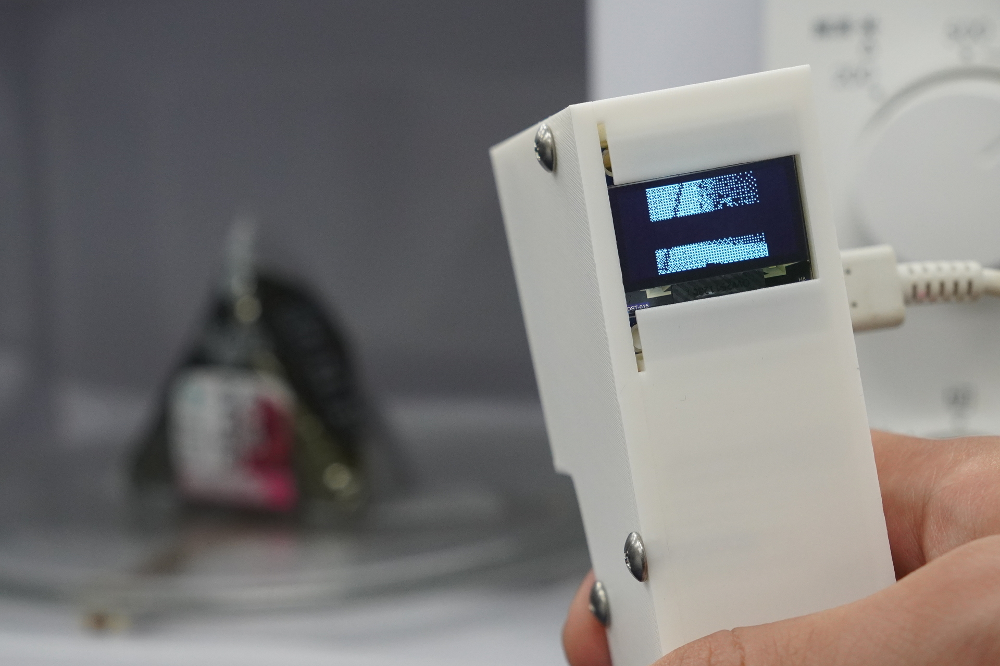

# レンピタ（れんぴた）



## 製品概要

### 背景（製品開発のきっかけ、課題等）

電子レンジで食品を加熱する際、加熱時間の設定は食品の種類や量、容器の形状などによって大きく変わります。従来の電子レンジでは、ユーザーが手動で加熱時間を設定する必要があり、適切な加熱時間を見つけるのは難しい場合があります。

### 製品説明（具体的な製品の説明）

この製品は、一般的なカメラで撮影された画像から食品の種類や量を自動的に認識し、適切な加熱時間を推定するシステムです。ユーザーは食品の画像を撮影するだけで、システムが自動的に加熱時間を計算し、ユーザーに最適な加熱時間を提案します。これにより、食品の過熱や未加熱のリスクを減らし、より安全で効率的な加熱が可能になります。

### 特長

#### 1. 特長1

食品にレンピタのカメラを向けるだけで食品の種類や量を自動的に認識し、適切な加熱時間(600W)を推定します。

#### 2. 特長2

結果を出力するのに時間がほとんどかかりません。

### 解決できること

感覚に頼っている電子レンジの加熱時間設定を、科学的に推定できます。どのような電子レンジでも（古さ、機能性にかかわらず）対応が可能です。

### 今後の展望

* デバイス単体で動作するように軽量化および最適化を行う
* さまざまな々な画像で動作検証
* さまざまな食品で動作検証
* ターンテーブルではない電子レンジにも対応

### 注力したこと（こだわり等）

*操作が対象物にむけて出力を見るだけときわめて単純なこと
* 単眼カメラだけでものの大きさを推定できるようにしたこと
* 現実的な速度で推論できるようにしたこと
* 現実的に問題がない部分は大胆に近似したこと

## 開発技術

### 活用した技術

#### 加熱時間推定

* [Python](https://www.python.org/)（プログラミング言語）
* [ONNX](https://onnx.ai/)（機械学習モデルの形式）
* [OpenCV](https://opencv.org/)（画像処理ライブラリ）
* [NumPy](https://numpy.org/)（数値計算ライブラリ）
* [FastAPI](https://fastapi.tiangolo.com/)（Webフレームワーク）
* [Uvicorn](https://uvicorn.dev/)（ASGIサーバー）
* [uv](https://docs.astral.sh/uv/)（Pythonのパッケージ管理ツール）
* [YOLOv8-seg](https://docs.ultralytics.com/models/yolov8/)（食品の検出とセグメンテーション）
* [Depth Anything](https://github.com/DepthAnything/Depth-Anything-V2)（深度推定）

#### デバイス

* [M5Stack AtomS3R CAM](https://docs.m5stack.com/en/core/AtomS3R-CAM)（単眼カメラ搭載の小型マイコン）
* [MLX90640](https://www.melexis.com/en/product/MLX90640/thermal-infrared-sensor-array)（赤外線センサー）
* [Arduino IDE](https://www.arduino.cc/en/software)（マイコンの開発環境）

### 独自技術

#### ハッカソンで開発した独自機能・技術

* 単眼カメラでものの大きさを推定するアルゴリズム

## 起動方法

### 前提条件

以下がインストールされていること。

* [uv](https://docs.astral.sh/uv/)
* [git](https://git-scm.com/)

```bash
# このリポジトリをクローンして、uv syncを実行する。
git clone https://github.com/jphacks/kz_2602.git
cd kz_2602
uv sync
```

詳細は[docs/](./docs/)を参照してください。
