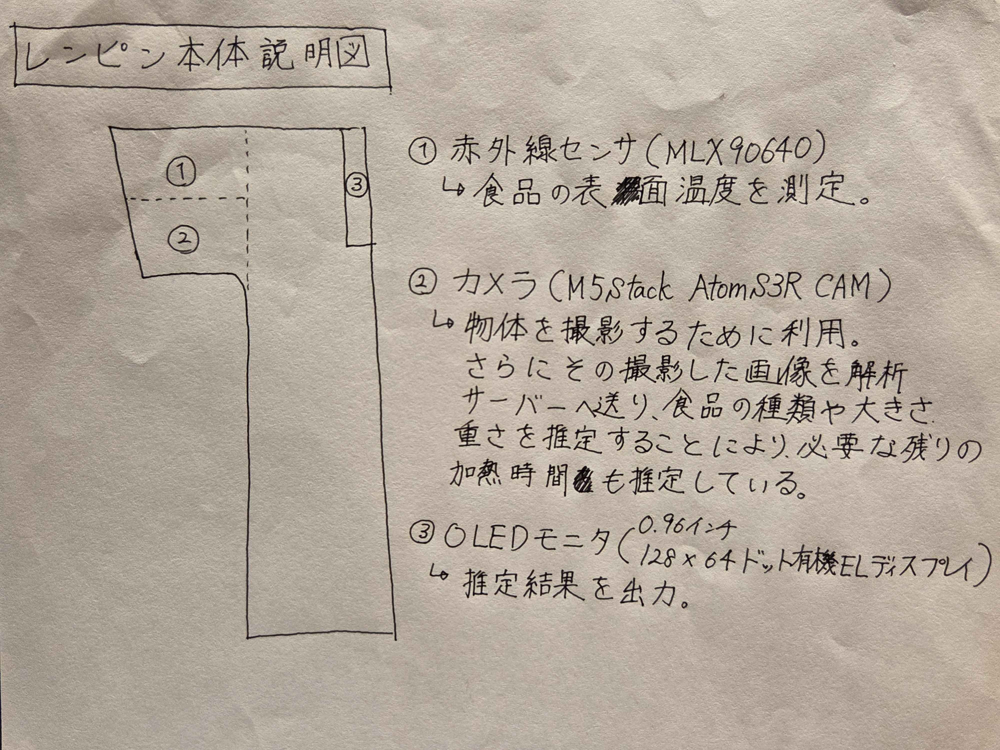
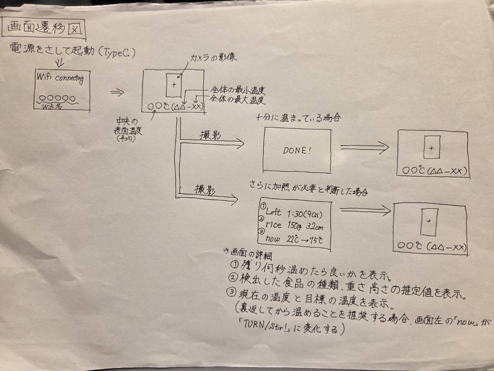
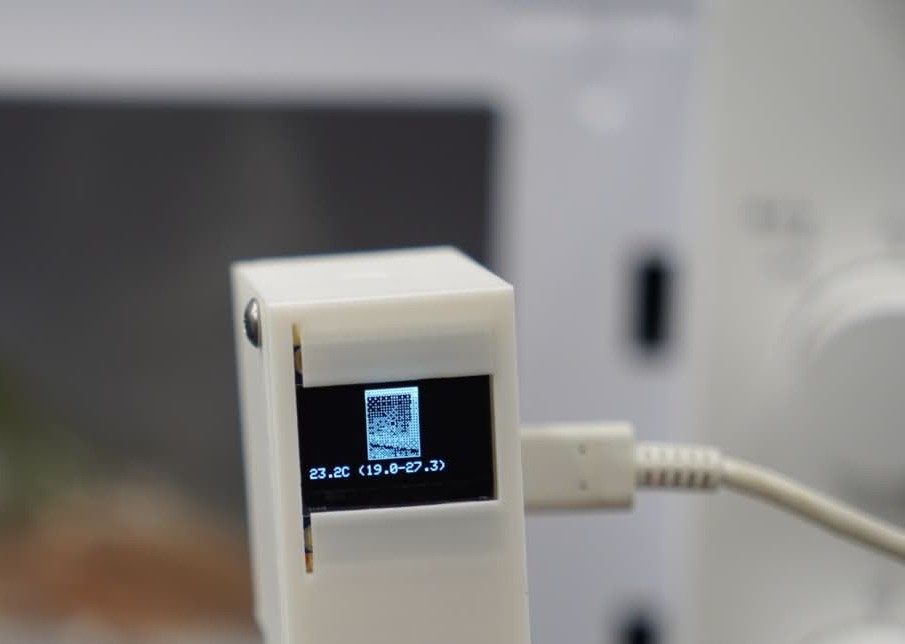
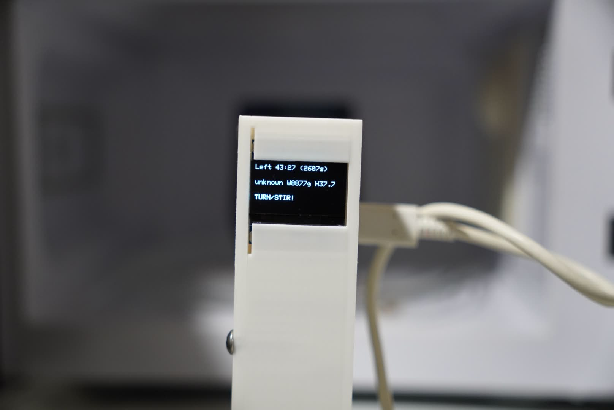

# ハードウェア（レンピン本体）説明書

これは、レンピン本体に関する説明所です。画像中の文章と、画像下の文章の内容はほとんど一緒ですが、一部説明を加えています。ぜひ、後者もご覧ください。

## レンピン本体説明書

### ①赤外線センサ（MLX90640）  
→食品の表面温度を測定するために利用しました。

### ②カメラ（M5Stack AtomS3R CAM）  
→物体を説明するために利用しました。さらにその撮影した画像をPC本体の画像解析サーバーへ転送し、食品の種類や大きさ、重さを推定するとともに、それらの推定値から必要な残りの加熱時間も推定しています。

### ③OLEDモニタ（0.96インチ、128×64ドット有機ELディスプレイ）  
→これまでの推定結果を出力します。出力されるものは、残り時間、そのほか上記の推定値を画面に表示します。画面表示に関する詳細事項は、次の画面遷移図をご覧ください。

## 画面遷移図

### 実際にモニターに表示される画面

#### ①物体を撮影する際の画面

#### ②推定結果を表示している画面

