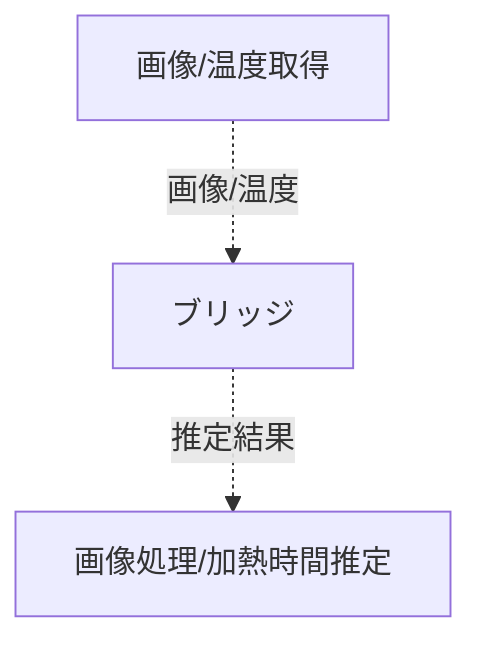

# システム全体のつながり概要

システム全体の構成と各モジュール間の関係を示します。

## モジュール

### 画像/温度取得

カメラと赤外線センサーを搭載した専用デバイスで、画像と温度を取得します。詳細は[こちら](./hardware_explanation.md)をご覧ください。

HTTPサーバーとしてふるまい、外部からのリクエストに応じて画像と温度データを返します。

### 画像処理/加熱時間推定

取得した画像と温度データを用いて、食品の体積・加熱パラメーターを推定し、最適な加熱時間を算出します。詳細は[こちら](./design.md)をご覧ください。

HTTPサーバーとしてふるまい、外部からのリクエストに応じて加熱時間を返します。

### ブリッジ

画像取得/温度取得モジュールと画像処理/加熱時間推定モジュールの間でデータを中継します。[../hardware/renping_bridge.py](../hardware/renping_bridge.py)を参照してください。

